<!-- markdownlint-disable MD033 -->
# iOpenPod: iPod Manager and iTunes replacement

<p align="center"><strong>
iOpenPod
</strong></p>

<p align="center">
  
</p>

<p align="center"><strong>Manage your iPod without iTunes.</strong></p>

<p align="center">
  <a href="https://github.com/TheRealSavi/iOpenPod/releases/latest"></a>
  <a href="#download-and-install"></a>
  <a href="LICENSE"></a>
  <a href="https://discord.gg/9Yy499Tf5d"></a>
</p>

<p align="center">
  <a href="https://github.com/TheRealSavi/iOpenPod/releases"></a>
  <a href="https://pepy.tech/projects/iopenpod"></a>
  <a href="https://github.com/TheRealSavi/iOpenPod/stargazers"></a>
  <a href="https://github.com/TheRealSavi/iOpenPod/graphs/contributors"></a>
</p>

<p align="center">
  <strong><a href="https://github.com/TheRealSavi/iOpenPod/releases/latest">Download</a></strong>
  · <a href="https://iopenpod.com">Website</a>
  · <a href="https://iopenpod.com/guides/">Guides</a>
  · <a href="https://discord.gg/9Yy499Tf5d">Discord</a>
</p>

A free, open-source iPod manager and iTunes alternative for **Windows, macOS, and
Linux**. Sync music and other media from your computer to your iPod.

We are actively researching and reverse engineering iPod firmware, to push knowledge of these devices forward, add new features, and keep support alive. This is not a small rewrite of libgpod, this is iOpenPod.

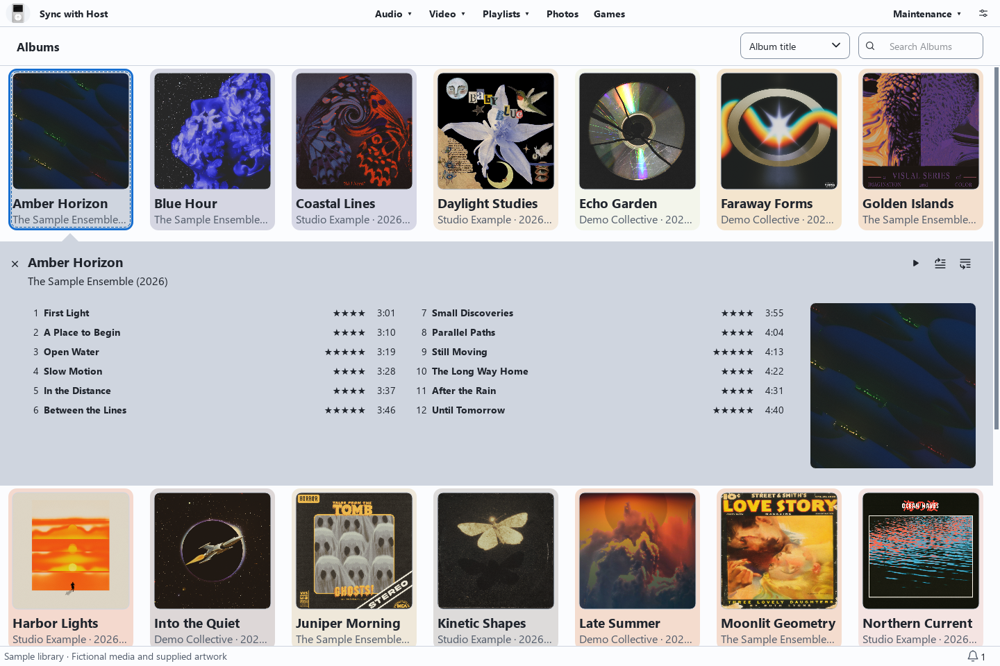

[Features](#what-you-can-do) · [Installation](#download-and-install) ·
[First Sync](#how-to-use) · [Compatibility](#ipod-compatibility) ·
[Contributing](#develop-and-contribute) · [Support](#support)

> [!IMPORTANT]
> Built for filesystem-accessible **iPod Classic, iPod mini, iPod nano, and earlier iPods**.
> iPhone, iPod Touch, other iOS devices, and iPod Shuffle are not yet supported.
>
> [Check compatibility](#ipod-compatibility).

## What you can do

| Feature | Detail |
| --- | --- |
| **Music, Album Artwork & Track Metadata** | Full support to browse, sync, listen, and edit, even niche fields like chapter data, media type, compilation flags, play counts, and ratings. This is iPod centric software made to replace iTunes, it's all here.  |
| **Playlists & Smart Playlists** | Arrange tracks, make playlist folders, and create rule-based smart playlists with nested rules just like iTunes.. |
| **Sync & Conversion** | Automatically converts audio and video to support your iPod, no more need for external tools or managing multiple copies of the same media. iOpenPod leaves your computer files alone, and associates the transcoded iPod copy to it. |
| **Click Wheel Games. Including Phase** | Install the entire preserved game collection without a virtual machine, and generate the Phase playlist with advanced GPU accelerated music listening. |
| **Playback & Synesthesia** | Listen with desktop intergrated media controls and explore a new advanced music-reactive visualizer. |
| **Photos** | Browse and organize Photos into Albums and export photos from your iPod onto your PC to keep those old memories safe. |
| **Podcasts** | Browse the iTunes Podcasts API and automatically or manually have podcasts sync. Full support for chapters, chapter artwork, per episode artwork, and proper grouping. Not even iTunes does this properly :) |
| **Scrobbling** | Optionally submit iPod music plays to Last.fm or ListenBrainz. |
| **Backups** | Backup your devices and restore to that point at anytime. |

<details>
<summary>See Screenshots</summary>

| Track metadata                                                                                                                                                                                | Track artwork                                                                                                                                                                             |
| --------------------------------------------------------------------------------------------------------------------------------------------------------------------------------------------- | ----------------------------------------------------------------------------------------------------------------------------------------------------------------------------------------- |
| 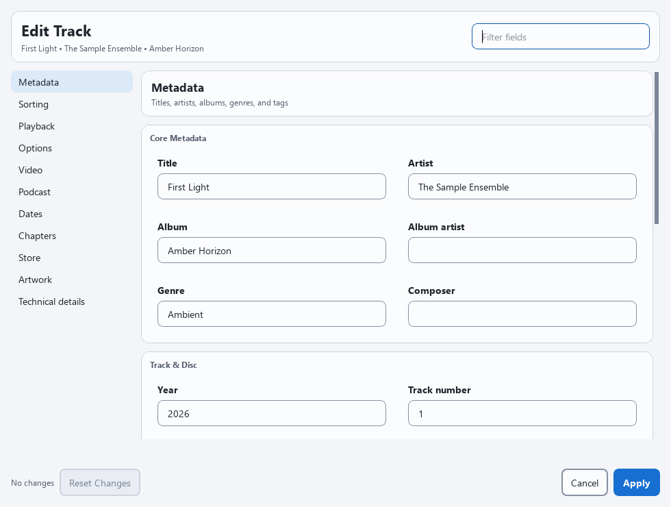 | 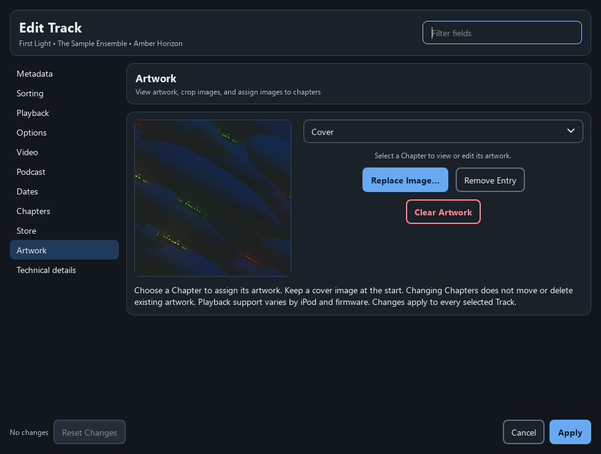 |

| Smart Playlists                                                                                                                                                              | Backups                                                                                                                                                                         |
| ---------------------------------------------------------------------------------------------------------------------------------------------------------------------------- | ---------------------------------------------------------------------------------------------------------------------------------------------------------------------------------------- |
| 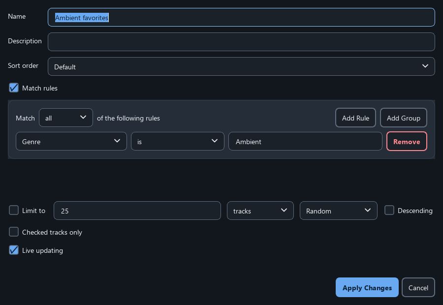 | 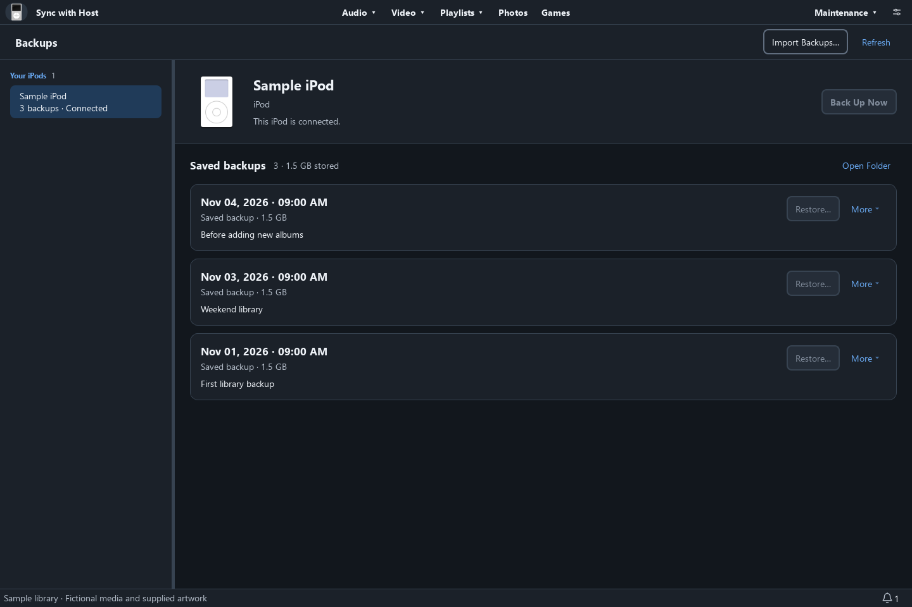 |

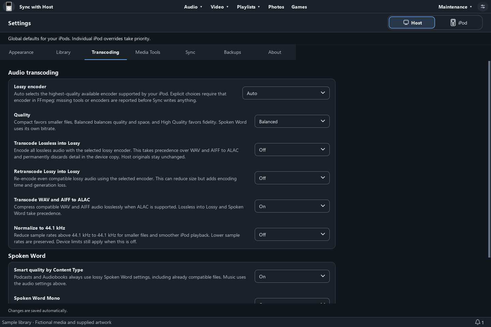

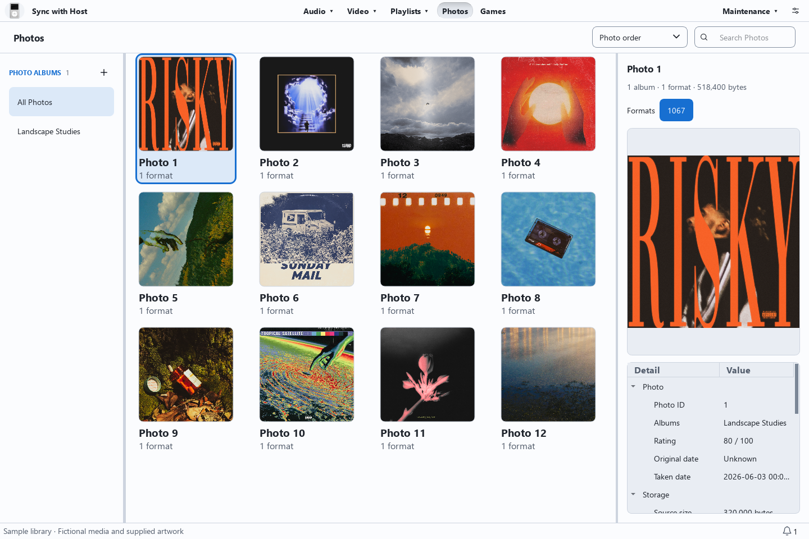

</details>

## Download and install

<a href="https://get.microsoft.com/installer/download/9p2lxchhwlg9?referrer=appbadge">
    
</a>

Native downloads for Windows, macOS, and Linux are available on the
[latest release page](https://github.com/TheRealSavi/iOpenPod/releases/latest).
Choose your platform below; these downloads do not require a separate Python installation.
See the [installation guide](https://iopenpod.com/install-help/) for setup and troubleshooting.

| Platform              | Latest release assets                                                           | Installation                                                           |
| --------------------- | ------------------------------------------------------------------------------- | ---------------------------------------------------------------------- |
| Windows x64           | [Windows x86\_64 ZIP](https://github.com/TheRealSavi/iOpenPod/releases/latest)  | Extract `iOpenPod.exe` and run it.                                     |
| macOS · Apple Silicon | [macOS arm64 DMG](https://github.com/TheRealSavi/iOpenPod/releases/latest)      | Open the image and drag `iOpenPod.app` to Applications.                |
| macOS · Intel         | [macOS x86\_64 DMG](https://github.com/TheRealSavi/iOpenPod/releases/latest)    | Open the image and drag `iOpenPod.app` to Applications.                |
| Linux x64             | [Linux x86\_64 tar.gz](https://github.com/TheRealSavi/iOpenPod/releases/latest) | Extract the complete folder and run its top-level `iOpenPod` launcher. |

<details>
<summary>Windows setup and in-app updates</summary>

On Windows, keep the file name as `iOpenPod.exe` and place it in a folder you can write to
on a fixed NTFS drive for in-app updates. Windows users can also install through
[Microsoft Store](https://apps.microsoft.com/detail/9P2LXCHHWLG9).

</details>

<details>
<summary>macOS setup and first launch</summary>

On macOS, launch from Applications after copying the app and ejecting the DMG.
The build targets macOS 12.3 or later. Current downloads are ad-hoc signed and not
notarized. Follow the [Mac setup guide](https://iopenpod.com/install-help/#native-macos)
for first-launch approval in **System Settings → Privacy & Security**. Choose a
DMG to install; the ZIPs labeled `sparkle-update` are reserved for the built-in updater.

</details>

<details>
<summary>Linux setup, diagnostics, and recovery storage</summary>

On Linux, extract into a folder you can write to, preserve executable permissions,
and keep the whole `iOpenPod` folder together. Always start its top-level launcher,
including after an update. The binary is built on Ubuntu 24.04 and requires glibc
2.39 or later plus desktop libraries.

If Linux does not launch the app, run its top-level launcher from a terminal to
see the startup error. For device-access problems, the Device Picker includes the
underlying error. **Settings → About** shows a copyable log file path even if
**Open Log Folder** fails. The default Linux log is
`~/.local/state/iOpenPod/iopenpod.log`, or `$XDG_STATE_HOME/iOpenPod/iopenpod.log`
when `XDG_STATE_HOME` is configured; a custom log setting takes precedence.

Linux device selection also validates that persistent Host recovery storage is
separate from the selected iPod. Unsupported or incomplete storage layouts are
blocked with a diagnostic. Btrfs recovery is supported when every member device can
be verified as separate from the iPod; loop-backed recovery remains unsupported.
See [the backing-storage contract](docs/adr/0191-compare-live-linux-physical-backing.md)
and [Btrfs recovery support](docs/adr/0193-resolve-btrfs-recovery-through-all-member-devices.md)
for supported layouts and remaining Linux acceptance work.

</details>

Mac App Store, Flathub, and Snap Store remain planned. Check the
[website](https://iopenpod.com/#install) for channel availability.

<details>
<summary>Updating a GitHub installation</summary>

iOpenPod checks for updates at launch. You can also use **Settings → About →
Check for updates**. About shows your current version and Install Channel.

* **Windows and Linux:** choose **Update now** to download the update, then
  **Restart to install** when ready. Save any Library Draft and finish running
  workflows first. Close other iOpenPod instances before restarting.

* **macOS:** choose **Update now** after saving your work, then follow the built-in
  updater's installation and relaunch prompts.

Installation requires your choice. If an older build only offers **Open download
page**, or cannot update itself, install the latest download from above manually.
Older Linux directory bundles should be replaced by extracting the new archive
into a fresh folder.
Microsoft Store installations update through the Store.

</details>

<details>
<summary>Install or update from PyPI with uv</summary>

First [install uv](https://docs.astral.sh/uv/getting-started/installation/),
then run:

```shell
uv tool install iopenpod
```

Launch the app with `iopenpod`. For updates, choose **Update now**, then
**Restart to install** in the app. Or manually run

```shell
uv tool upgrade iopenpod
```

</details>

### Media tools

**FFmpeg and FFprobe** are installed separately for media conversion and inspection.
**Chromaprint's fpcalc** is optional, installed separately, and enables acoustic
matching during Sync.

The startup popup or **Settings → Media Tools → Set Up Media Tools** can install
missing tools after you choose **Install Missing Tools**. Native setup uses WinGet,
Homebrew, or a supported Linux package manager.

## How to use

1. **Connect your iPod** and select it in the device picker. Your operating system
   must be able to mount and access it.
2. **Choose Sync with Host**, add media folders, and select what to scan.
3. **Select your media**, then review additions, updates, and removals. Removal
   candidates start unchecked.
4. **Sync Selected** prepares compatible media and publishes verified changes.
   Use the app’s eject action when you are finished.

Optional acoustic matching helps recognize the same recording after format or
metadata changes. Sync can also recognize media from a previous successful Sync
without generating a new fingerprint.

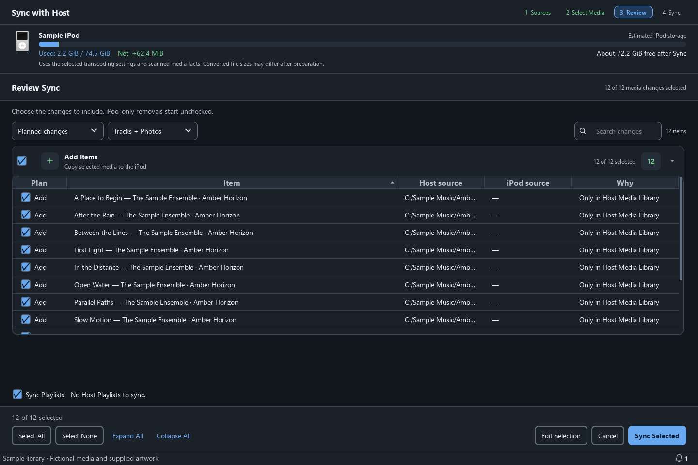

<details>
<summary>See the folder and media selection steps</summary>

| Media folders                                                                                                                                                                              | Sync selection                                                                                                                                                                                 |
| ------------------------------------------------------------------------------------------------------------------------------------------------------------------------------------------ | ---------------------------------------------------------------------------------------------------------------------------------------------------------------------------------------------- |
| 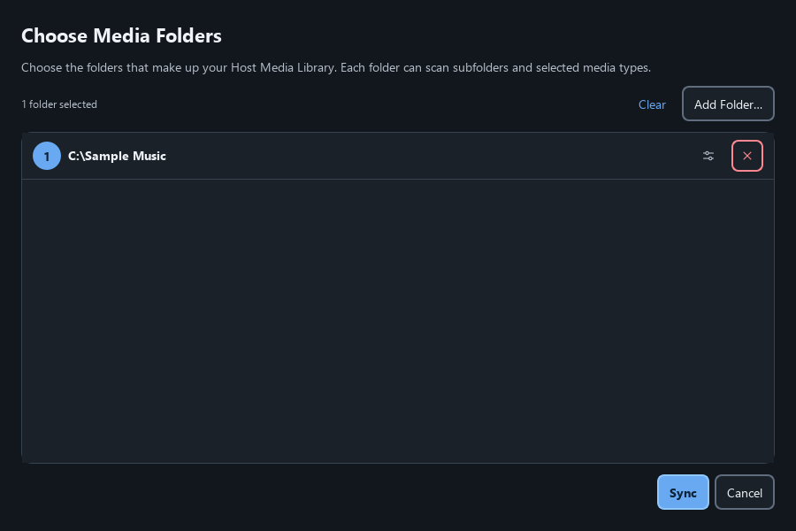 | 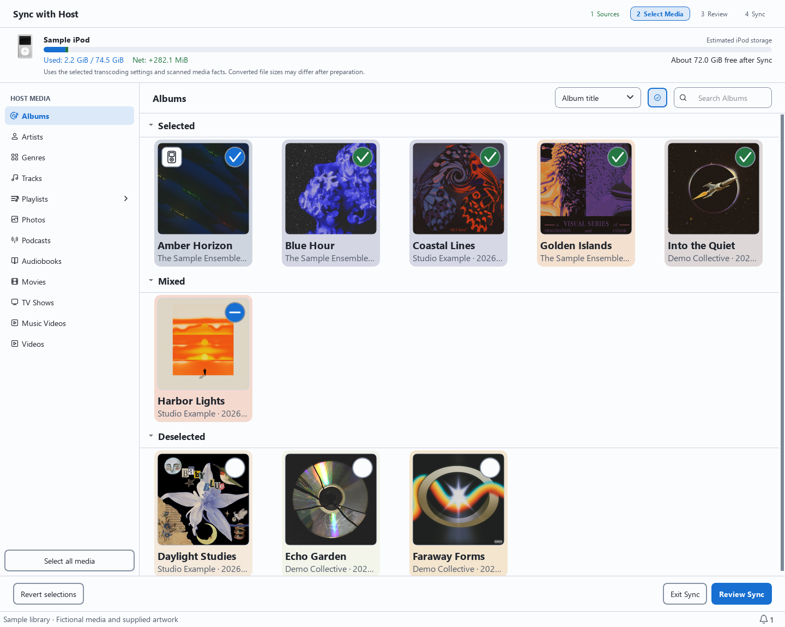 |

</details>

## Click wheel games and Phase

**Install click wheel games without a virtual machine.**

Start with one click on **Install Games** in the Games page. iOpenPod downloads
the full preserved click wheel game collection and prepares game authorization
for your iPod. Choose **Select all → Add** to install the collection, or pick
individual games. No virtual machine is required.

The first download needs an internet connection; later visits reuse the files
on your computer. Game compatibility depends on your iPod model and firmware.

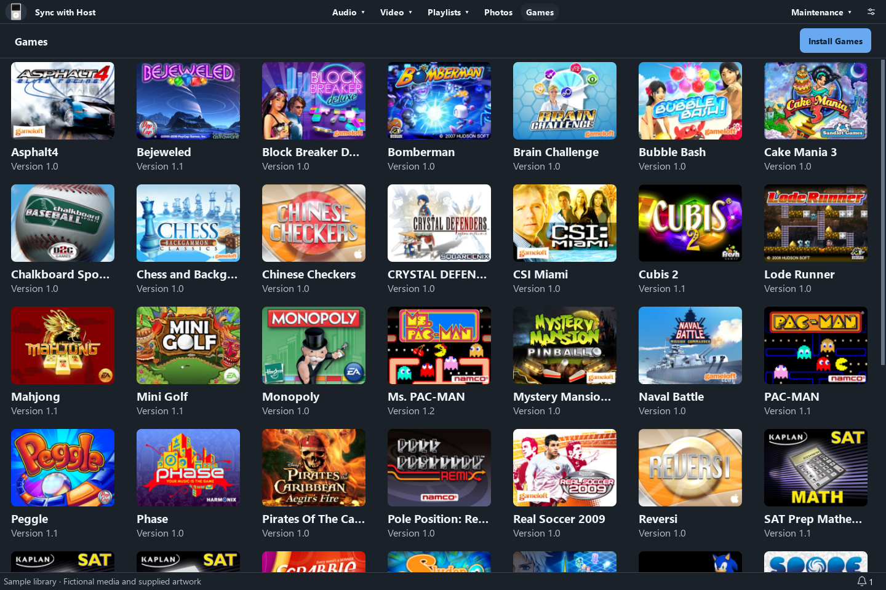

<details>
<summary>Make a Phase Playlist from your music</summary>

With Phase installed, create a Phase Playlist or mark an existing playlist with
**Use as the Phase Playlist**. Add your songs and save. iOpenPod generates the
audio analysis the game uses to turn your music into gameplay, and reuses matching
analysis on later saves.

The analyzer detects beats and musical attacks, with an emphasis on audible
percussion. With the optional music analysis model installed, it also separates
estimated vocals, drums, guitar, bass, piano, and other sounds, and recognizes
recurring musical phrases. These help it follow the rhythm and prominent parts
of a song. Acoustic analysis works without the optional model. Use **Settings →
Media Tools → Set Up Phase Analysis** to download optional instrument analysis;
setup can use several gigabytes. If optional analysis cannot run, iOpenPod uses
acoustic analysis. Audio decoding uses your configured FFmpeg executable.

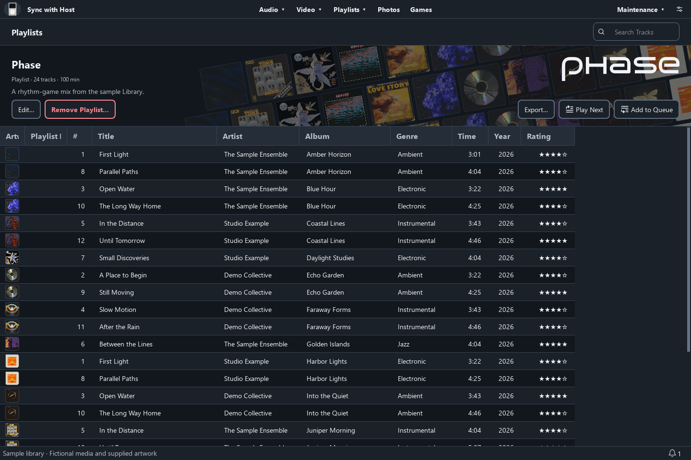

</details>

## iPod compatibility

iOpenPod targets these iPod families. Available features depend on the model.

| Family                | Target                                             |
| --------------------- | -------------------------------------------------- |
| iPod and iPod classic | Full-size generations 1–5.5 and the classic family 6-7 |
| iPod mini             | 1st and 2nd generation                             |
| iPod nano             | 1st–7th generation                                 |

**iPod shuffle, iPod touch, iPhone, and other iOS devices are not yet supported.**

## Guides

* [Sync an iPod without iTunes](https://iopenpod.com/guides/sync-ipod-without-itunes/)
  — choose media folders and review your first Sync.
* [Check iPod compatibility](https://iopenpod.com/guides/ipod-compatibility/)
  — understand model and filesystem requirements.
* [Put FLAC music on an iPod](https://iopenpod.com/guides/flac-to-ipod/)
  — convert supported source files for your model during Sync.
* [Troubleshoot an iPod that is not detected](https://iopenpod.com/guides/ipod-not-detected/)
  — check the connection and whether the computer can access the device.

## Coming from iTunes or another iPod manager?

Here's what makes iOpenPod different.

* **No separate libgpod installation.** iOpenPod uses its own Python iPod database
  implementation, originally informed by libgpod and gtkpod research, but has been heavily modified and improved upon; expanding compatibility, fixing bugs, and adding features.

* **All features are free.** Donations support development without unlocking features. You will never hit a pay wall, and will be able to install it on any platform, Windows, macOS, or Linux, all for free.

* **Review before writing.** Sync shows planned changes, with removals unchecked by
  default. Backup Snapshots are user-controlled, and interrupted writes have
  explicit recovery actions.

## Develop and contribute

Clone the repository, open its directory, and use the locked UV environment:

```shell
git clone https://github.com/TheRealSavi/iOpenPod.git
cd iOpenPod
uv sync --locked
uv run python scripts/prepare_qt_typing.py
uv run -m iOpenPod
```

<details>
<summary>Qt typing and platform notes</summary>

The typing preparation command gives Pylance and Mypy the same corrected Qt 6.9.3
annotations on macOS without replacing the runtime. Run it after syncing or
recreating the environment; VS Code's **Environment: Sync** and **Typecheck: Mypy**
tasks include it. Newer Qt versions use their bundled stubs. See
[development typing](typings/README.md) for details and remaining platform diagnostics.

</details>

iPod Hardware testing, platform testing, reproducible bug reports with logs and relevant database files, and focused and communicated pull
requests all help.

For bug reports, include your iPod model, operating system,
iOpenPod version, steps to reproduce the problem, logs, and relevant database files if possible, this helps developers reproduce the issue.

Keep each pull request focused on one change. Discuss proposed work in an issue or
on [Discord](https://discord.gg/9Yy499Tf5d) before starting, especially for major
changes, so we can agree on the approach.

<details>
<summary>Run the development checks</summary>

Before submitting changes, run the repository checks:

```shell
uv lock --check
uv run ruff format --check .
uv run ruff check .
uv run rumdl check .
uv run mypy
uv run pytest
```

Full-suite runs use eight workers with whole-file scheduling by default, including
`uv run pytest tests` and `uv run pytest .` from the repository root. A focused
test path, `-k`, `-m`, `--lf`, or collection-only run defaults to serial. Add `-n8` to
parallelize a focused run; use `-n0` only when diagnosing a failure. CI and VS Code
inherit the same default. See the [test scheduling decision](docs/adr/0197-default-full-suite-tests-to-eight-workers.md).

</details>

<details>
<summary>Explore the architecture and engineering docs</summary>

The application ships as one distribution with four internal boundaries:

| Package               | Responsibility                                 |
| --------------------- | ---------------------------------------------- |
| `src/iOpenPod`        | Application workflows, state, and GUI          |
| `src/device_registry` | iPod identity and capabilities                 |
| `src/iPodDB`          | iPod database formats                          |
| `src/storage`         | Safe filesystem and removable-media operations |

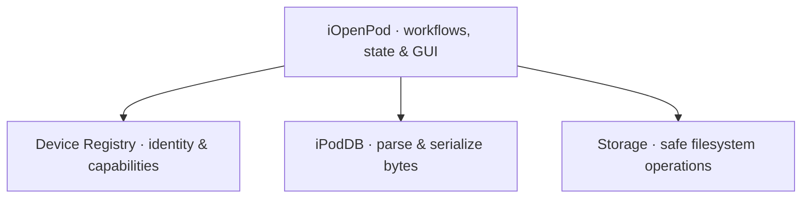

Device mutations belong in Storage. iPodDB works with bytes; lower-level
boundaries do not import iOpenPod.

Read [AGENTS.md](https://github.com/TheRealSavi/iOpenPod/blob/main/AGENTS.md), the [project context](https://github.com/TheRealSavi/iOpenPod/blob/main/CONTEXT.md), and the
[documentation map](https://github.com/TheRealSavi/iOpenPod/blob/main/docs/README.md) before making substantial changes.
[Packaging](https://github.com/TheRealSavi/iOpenPod/blob/main/docs/packaging.md) covers native builds and store release gates;
[website maintenance](https://github.com/TheRealSavi/iOpenPod/blob/main/website/README.md) covers screenshots and channel activation.

</details>

## Support

**Every feature is free.** Donations are optional and help a lot to support continued development.

[](https://ko-fi.com/johngibbons)
[](https://discord.gg/9Yy499Tf5d)

## Star history

<a href="https://www.star-history.com/?repos=therealsavi%2Fiopenpod&type=timeline&legend=top-left">
 <picture>
   <source media="(prefers-color-scheme: dark)" srcset="https://api.star-history.com/chart?repos=therealsavi/iopenpod&type=timeline&theme=dark&legend=top-left&sealed_token=aMCIa4pbVoIhlxj9qK6fW6xT1G5WPmVyftpcUHMTDCF-jNcb-ZD5ewReZkCnZxjUqpEYILAoYH1UP1nYDNyqT1PbhUaA09JI1Lrq1EZ2-mO9bYPn3EWaHyBxmimY3pGYha3MHx1aNeAXRuF0UoijWcDkCgvNBHYDbZNCLG6zG8wx6tDuSh8cmrTN0uas" />
   <source media="(prefers-color-scheme: light)" srcset="https://api.star-history.com/chart?repos=therealsavi/iopenpod&type=timeline&legend=top-left&sealed_token=aMCIa4pbVoIhlxj9qK6fW6xT1G5WPmVyftpcUHMTDCF-jNcb-ZD5ewReZkCnZxjUqpEYILAoYH1UP1nYDNyqT1PbhUaA09JI1Lrq1EZ2-mO9bYPn3EWaHyBxmimY3pGYha3MHx1aNeAXRuF0UoijWcDkCgvNBHYDbZNCLG6zG8wx6tDuSh8cmrTN0uas" />
   
 </picture>
</a>

## Related projects

* [libgpod](https://github.com/gtkpod/libgpod) - C library for iPod database access (the reference implementation this project learned from)

* [gtkpod](https://github.com/gtkpod/gtkpod) - GTK+ iPod manager

* [Rockbox](https://www.rockbox.org/) - Open-source firmware replacement for iPods

## License and credits

Licensed under **GPL-3.0-or-later**. All features are free; optional
[donations](https://ko-fi.com/johngibbons) support development without unlocking
features. See [LICENSE](https://github.com/TheRealSavi/iOpenPod/blob/main/LICENSE), [COPYING.md](https://github.com/TheRealSavi/iOpenPod/blob/main/COPYING.md), and
[ACKNOWLEDGEMENTS.md](https://github.com/TheRealSavi/iOpenPod/blob/main/ACKNOWLEDGEMENTS.md) for the license grant and third-party
credits, including HASHAB, libgpod, and gtkpod research. The application icon has
separate permission terms documented with its assets.

Special thanks to [Dylan Staley (@dstaley)](https://github.com/dstaley/hashab)
for the HASHAB WebAssembly implementation used by iOpenPod.

Thanks to [dotm5](https://github.com/dotm5) and their
[Genius-Mix-Research](https://github.com/dotm5/Genius-Mix-Research) repository for
helping us understand native Genius Data.

Thanks to [Olsro](https://github.com/Olsro) for organizing and preserving iPod
click wheel games through the
[iPod Clickwheel Games Preservation Project](https://github.com/Olsro/ipodclickwheelgamespreservationproject).
iOpenPod's game binary downloads are sourced from this repository.

Independent software, not affiliated with or endorsed by Apple Inc. iPod and
iTunes are trademarks of Apple Inc.

<!-- markdownlint-enable MD033 -->
