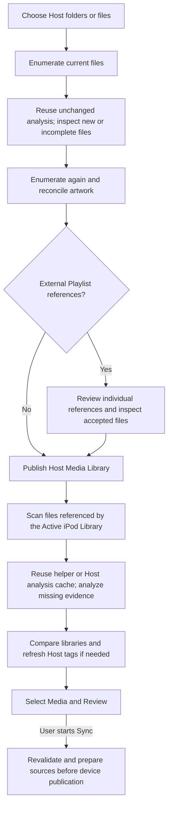

# How media scanning works

iOpenPod scans media to build a useful, reviewable picture of the Host and the
Active iPod. A scan reads the sources, reuses trustworthy analysis where it can,
and reports anything it could not inspect. It does not start copying music or
changing the iPod.

The important distinction is between **discovering what is available**, **analyzing
its contents**, and **authorizing a later Sync**. Keeping those separate lets a
scan continue when one optional file is troublesome without treating incomplete
information as permission to modify the device.

This describes the implementation examined in the two scan audits on
2026-10-22. The [Glossary](../GLOSSARY.md) defines the capitalized domain terms;
the [source architecture](source_architecture.md) provides the wider design.

## The complete journey

Device discovery and loading iTunesDB happen before the iPod Media Scan. That scan
works from the loaded Library's Track and Photo references. It does not recursively
search the whole iPod for unrelated files or orphaned media.

## A first Host scan

### 1. Establish the selected scope

The user selects folders, recursion and media-type settings, or individual files.
The scanner resolves those choices, handles overlaps, and builds a deterministic
catalog of supported audio, video, Photos, and Playlists. Ordinary hidden media
folders remain eligible; AppleDouble `._` files and `.AppleDouble` metadata
directories are excluded.

Storage performs the filesystem operations. It validates paths, observes regular
files, and pins directory access while checking for replacement. Folder links are
followed only under the explicit selection/link policy, with aliases and cycles
controlled. A Playlist reference does not inherit permission to follow arbitrary
links.

Directory work can overlap across up to four workers. The queue is bounded, so a
large directory tree does not create an unlimited number of tasks. An inaccessible
subfolder produces a diagnostic while independent folders continue. An interrupted
directory iterator gets one retry inside the same pinned access. A successful
retry supplies the current listing; persistent failure retains the entries that
could be inspected and reports the incomplete result.

### 2. Inspect the files that need work

The catalog records each file's normalized path, kind, size, and modification
time. Those facts are compared with the Host Media Scan Cache. On the first scan,
most files will have no reusable record.

Up to eight inspection workers process independent files:

| Source | Analysis retained |
| --- | --- |
| Audio or video | Track metadata, optional Acoustic Fingerprint, and an artwork reference |
| Photo | Dimensions and an exact SHA-256 Image Content Fingerprint |
| Playlist | Name, ordered file references, and parse diagnostics |

Track fingerprints use Chromaprint's raw algorithm-2 output from at most the first
120 seconds of audio. This is approximate matching evidence, not proof that two
files have identical bytes. A full-resolution Photo's SHA-256 digest establishes
exact byte equality; it does not equate a resized image with the original.

Metadata and acoustic analysis have separate completion states. If metadata works
but `fpcalc` is missing or fails, the readable Track remains available. The next
scan can retry just the missing analysis. A specifically confirmed absence of an
audio stream is retained so a video without audio does not trigger the same
fruitless decode on every scan. Other decoder failures remain retryable.

Artwork is optional. A valid embedded image takes precedence; otherwise common
folder-cover names are tried in a deterministic order. The catalog stores a
reference and digest, not all the image pixels. Display loads pixels lazily and
revalidates the source. An unreadable or over-limit image can be reported while
another usable cover is selected. Unavailable artwork is distinguished from a
deliberate removal so later Sync does not erase a cover on that assumption.

### 3. Recheck the tree

After inspection, the scanner enumerates the selected scope again using fresh
observations. This detects ordinary additions, disappearances, and changed file
facts. Folder artwork is reconciled against this final view.

A tree change is a diagnostic rather than a reason to discard all useful work.
The result can contain previously inspected records whose sources subsequently
changed; newly arriving files may wait for the next scan. This is a best-effort
Library Snapshot, not a filesystem-wide transactional snapshot. Sync checks its
sources again before using them.

### 4. Resolve external Playlist references

A Playlist can refer to media outside the actual selected catalog, even inside a
selected folder when its type or recursion settings excluded that file. Those
references are presented for explicit review. An earlier cache hit never supplies
that approval.

Only accepted, supported, available Track files are inspected. Storage validates
the reviewed observation and makes a private capture for inspection. Changes or
disappearance cause that target to be omitted with a diagnostic. Accepting a Track
allows its embedded artwork, not inspection of neighboring images. Streaming URLs
and nested Playlists do not expand the scan; supported mounted network paths still
go through the filesystem and review policy.

The selected scope is rechecked after the review pause. Missing references and
parse warnings mark the affected Playlist incomplete, protecting later Playlist
reconciliation from treating missing information as intended membership removal.

### 5. Publish the Host Media Library

Successful completion creates a common, immutable Library Snapshot for browsing
and comparison. The accompanying Host Media Library retains source observations,
matching evidence, cache statistics, and diagnostics. Cancellation publishes no
completed snapshot.

## Why repeat scans are much faster

A warm scan still enumerates the source tree twice. It avoids the more expensive
content work for unchanged, complete records: media parsing, image reads, hashing,
and audio decoding. Reusing the same scanner can also avoid decoding the JSON
cache again when its on-disk revision is unchanged. Unchanged catalogs are not
rewritten.

The three persistent stores serve different purposes:

| Store | Location and purpose | Reuse requirements | What it cannot establish |
| --- | --- | --- | --- |
| Host Media Scan Cache | Host application cache; Track metadata, fingerprints, Photos, Playlists, artwork references | Current normalized path, media kind, size, modification time, and completion state | Current bytes, external-file approval, or permission to write |
| iPod Analysis Cache | Host application cache; completed analysis of one physical device and Volume | Device/Volume binding, persistent item identity, Device Path, size, filesystem-aware modification time | A prior successful Sync or committed Sync Details |
| Library Sync Helper | `iPod_Control/iOpenPod/library-sync-helper.json`; reusable analysis and proven Sync history | Valid format/checksum and matching item identity, Device Path, size, filesystem-aware modification time | Library contents or authority to mutate the device |

Checksums detect damaged cache documents; they do not make cached source facts
authoritative. Host cache v16 reads supported older v9-v15 records, preserving
healthy reusable work. Incomplete Photos and failed Playlist reads are retried
without invalidating healthy neighbors. Successfully parsed Playlists with ordinary
parser warnings can be reused; older ambiguous records are reparsed once.

Completed new Host inspections are retained at completion checkpoints spaced at
least 30 seconds apart and when inspection exits, including cancellation. The iPod
Analysis Cache has the same general checkpoint/exit policy. A later attempt starts
with fresh source observations and reuses completed work; it does not resume an
old open directory iterator or a disconnected Filesystem Session. Work still in
progress at interruption may need to run again.
Accepted external Playlist files also retain completed, revalidated analysis on
this schedule, but each new scan requires fresh approval of external references.

**The deliberate limit:** an edit that preserves every cache discriminator can
escape warm-cache detection. Hashing every media file on every scan would defeat
the main speed advantage. Full capture, content verification, source validation,
and transaction preconditions remain separate requirements of the operations that
need stronger evidence.

## Scanning the iPod

The coordinator reserves the Active iPod and uses its validated Filesystem Session.
That session belongs to a specific device, Volume, Mount Point, and Connection
Generation. It checks the loaded Library database fingerprint before and after the
scan. A disconnect or invalidated session stops the scan; reconnecting requires
fresh authorization rather than reusing the old session.

For each referenced Track or retained full-resolution Photo, the scanner observes
current file facts and tries the Library Sync Helper and Host iPod Analysis Cache.
Only missing or stale analysis requires content reads. Photos that have only packed
or resized representations remain visible without a fabricated full-resolution
fingerprint.

Native Track analysis uses a pinned, seekable, read-only input. The decoder can
seek to a container index and read the audio window without first copying the
whole movie or audiobook to the Host. Native device decodes are serialized. This
is a time-limited audio window, not a fixed byte budget: container layout and
bitrate still matter. Injected Host-only analyzers use a bounded private-capture
fallback. Photo hashing necessarily reads the complete full-resolution image.

The ordinary pre-Review scan sets helper persistence off. It can therefore run
against a read-only iPod and retain newly completed analysis on the Host. It does
not write the Library Sync Helper or invent a Sync timestamp. Successful Sync
publication owns committed Sync Details.

If the helper has a transient read or concurrent-change failure, the scan retries
one fresh observation. If it remains unavailable, independent media analysis can
continue without its evidence. The unreadable helper remains protected from
replacement, and its unknown Sync history is not reconstructed from the Host
cache. Session failure still stops the scan.

## Recovery without pretending a failure was success

| Situation | Scan response |
| --- | --- |
| One unreadable folder or media file | Keep independent results and identify the affected source |
| Temporary directory enumeration failure | Retry once; retain a diagnosed partial listing if it still fails |
| Damaged or unwritable Host cache | Continue analysis; rebuild or retry persistence later |
| Failed Playlist read or Photo analysis | Retain incomplete state and retry on a later scan |
| Missing `fpcalc`, timeout, or decoder failure | Keep useful metadata; leave missing acoustic evidence explicit |
| Corrupt or oversized optional cover | Try another valid cover; report unavailable artwork if no usable cover remains |
| Valid pre-1970 file timestamps or unusual native filenames | Preserve signed timestamps and filesystem names through snapshot identities and cache serialization |
| Internally inconsistent cached embedded-artwork facts | Reject the invalid cache and rebuild analysis from the source |
| Source changes during a read | Reject that observation or capture; never label partial bytes complete |
| Cancellation after a worker has already finished | Discard queued result/error/progress instead of opening Review |
| Device disconnect or session invalidation | Stop device work and discard completion; retain independently completed Host cache work |

Whole-file Storage reads and captures stop at the size observed on the opened
source. They do not probe beyond EOF, chase a growing file, or accept a premature
EOF as success. Descriptor and final named-path checks detect ordinary replacement
or changes. Parent directories are pinned for read access so swapping a directory
for a link cannot redirect a read outside the authorized tree.

Cancellation is cooperative: checkpoints and tool-process cancellation stop work
at safe boundaries. A blocked operating-system filesystem call can still delay
the response. Retry counts are bounded; an absent device or permanently denied
file cannot be made readable by repeatedly claiming success.

## From scan results to Sync Review

The application compares the two libraries using available identity evidence. When
iPod tags differ from their committed baseline but Host file facts appear
unchanged, it refreshes the affected Host metadata before presenting the plan.
Changing or disconnecting the Active iPod invalidates that handoff.

Select Media and Review show diagnostics from both scans. iPod-only removal
candidates start unselected; a partial Host scan therefore does not automatically
delete the iPod files it could not see. Deselecting an already correlated Host
item is a separate, explicit membership choice. Incomplete Playlist information
cannot silently authorize destructive Playlist reconciliation.

Starting Sync is another workflow with its own source and Active iPod validation,
preparation, verified Storage operations, and recovery. A successful scan is useful
evidence for Review, not a promise that sources will stay unchanged afterward.

### Why a metadata edit sometimes causes whole-file work

An Update in Review does not necessarily mean that media will be transcoded.
Sync compares media evidence, semantic tags, artwork, and embedded-tag policy
separately. The resulting work depends on which of those changed:

| Change | Work performed |
| --- | --- |
| Ordinary title, album, artist, or similar tags; Rockbox Metadata Support off | Update iTunesDB while retaining the media file |
| Artwork assignment on a device with native artwork support; Rockbox off | Update artwork records and thumbnail data while retaining the media file |
| Lyrics, or embedded tags/artwork required by Rockbox | Capture the existing file, rewrite its tags, verify it, and publish a staged replacement at the same location; retain encoded media |
| Changed audio evidence, unavailable evidence with changed Host facts, or changed stream preparation | Prepare and transfer replacement media, including transcoding when required |

A staged tag rewrite can therefore read and write the entire file without running
an encoder. This is particularly noticeable for large videos. Storage retains the
original for recovery until the new file and Library commit are verified. The
application must also refresh that file's size and timestamp in the Library Sync
Helper while preserving its original Host matching evidence and Sync Details.
Otherwise the next scan could mistake iOpenPod's own tag rewrite for unrelated
media, especially when transcoding changed the acoustic fingerprint slightly.

For ordinary audio, equal cached Acoustic Fingerprints retain the media even when
Host tags change the file's size or timestamp. Separate Host and committed iPod
tag baselines avoid repeated Updates caused by normalization. A metadata-only
Sync advances those baselines after a successful commit. Subsequent unchanged
scans should then produce In sync.

Video requires a more conservative rule. The default audio fingerprint cannot
prove that pictures, another audio stream, or subtitles stayed the same. Under
[ADR-0158](adr/0158-remember-stream-choices-and-committed-video-preparation.md),
changed Host file facts for video or a Track previously prepared with an explicit
stream choice require media preparation, including when an external editor changed
only container tags. Changing or restoring a saved stream choice also requests
preparation once. A versioned subtitle-conversion correction can likewise require
one new preparation even though the user's selections did not change. After
successful publication, its new receipt prevents that correction repeating.
An iPod Library metadata edit alone does not change Host file facts or stream intent.

The follow-up regressions exercise real Host scans, FFmpeg conversion, Chromaprint,
editor saves, fresh iPod scans, and another Sync. WAV, AAC M4A, and ALAC M4A sources
cover Host tag edits and iPod title/lyrics edits; the M4A cases include embedded
covers and chapters, with both retained M4A and transcoded MP3 outputs. They forbid
media preparation during the metadata-only Sync,
check unchanged encoded audio and location, and require the next comparison to be
unchanged. Planner tests also cover successive Host tag edits and durable stream
choices. A synthetic MKV-to-M4V regression includes selected video, audio, and
subtitles, followed by an ordinary editor artwork save with Rockbox off and on.
It verifies unchanged encoded media, retained Sync Details after a fresh scan,
restored stream preferences, and no preparation on the next Sync. Bypassing the
retained-file helper refresh makes that regression fail with lost Sync Details.
The focused follow-up completed with 158 passing tests; Ruff, Mypy, strict Pyright
for the new tests, and the documentation checks passed.

These checks do not claim that changed video containers can currently avoid
preparation, or that a missing fingerprint proves unchanged audio.

## What makes it fast, and what has been measured

The main savings come from avoiding repeated content analysis, reusing enumerated
directory entries for folder covers, bounding parallel Host work, and avoiding
whole-file device captures for native acoustic analysis. Progress is coalesced
before queued GUI delivery while preserving phase boundaries and final totals.

A controlled first-pass Windows fixture contained 1,500 small WAV Tracks and 75
folder covers with stub fingerprints. Its optimized scanner measured a median
2.269 seconds cold and 0.382 seconds warm; a restarted warm scanner took 0.451
seconds. Every warm run reused all Tracks with **zero media/cover reads, metadata
parses, fingerprint calls, or cache writes**. It still performed 152 directory
listings, as required by the two fresh tree passes.

These timings isolate scanner/cache overhead and predate the second-pass fixes.
They are not predictions for real USB, cloud, or NAS libraries. The
[performance investigation](research/host-media-scan-performance.md) records the
fixture, baseline comparison, operation counts, and limitations. Real first-scan
time is often dominated by filesystem latency and decoding.

## Where to investigate a slow or incomplete scan

The log separates Host enumeration, folder-artwork discovery, and inspection, with
elapsed times and operation counts. A warm scan with `inspected=0` and
`fallback_listings=0` is avoiding content work. If it is still slow, investigate
directory metadata latency and filesystem/provider behavior. Repeated inspection
of otherwise unchanged files may instead reflect incomplete metadata or retryable
acoustic analysis.

For a reproducible report, keep the scan diagnostics, the stage timings, whether
it was a first/repeat/restarted scan, the storage type, and whether the same files
behave differently on local storage. Native WebDAV, cloud hydration, and USB
behavior still require testing on the affected provider and hardware.

## Validation from the second pass

The final Windows run completed with **6,826 passed, 14 platform-specific skips,
and one expected Pillow warning from an existing large-Photo preparation test**
in 21 minutes 10 seconds. Dependency-lock validation, Ruff formatting and lint,
Mypy, and Rumdl also passed.

The regressions exercise real temporary Host files and native Windows handles,
virtual iPod Volumes, controlled read failures, path replacement, queued
cancellation, restarted caches, and source changes between analysis steps. These
tests verify recovery and safety behavior; they do not substitute for physical
iPod, macOS/POSIX, or mounted-network performance validation.

### Implementation map

| Responsibility | Source |
| --- | --- |
| Host scanning, cache, artwork, snapshots | [host_media_library.py](../src/iOpenPod/app/host_media_library.py) |
| Linked Host traversal | [host_media_traversal.py](../src/iOpenPod/app/host_media_traversal.py) |
| Host observations and safe streams | [host_input.py](../src/storage/host_input.py), [host_directory.py](../src/storage/host_directory.py) |
| Device reads and captures | [_filesystem.py](../src/storage/_filesystem.py) |
| iPod analysis and helper provenance | [library_sync_helper.py](../src/iOpenPod/app/library_sync_helper.py), [ipod_analysis_cache.py](../src/iOpenPod/app/ipod_analysis_cache.py) |
| Background work and cancellation | [host_media_controller.py](../src/iOpenPod/app/host_media_controller.py), [ipod_media_controller.py](../src/iOpenPod/app/ipod_media_controller.py) |
| Active iPod/session validation | [device_coordinator.py](../src/iOpenPod/app/services/device_coordinator.py) |
| Scan handoff and review | [main_window.py](../src/iOpenPod/GUI/main_window.py), [sync_workspace.py](../src/iOpenPod/GUI/sync_workspace.py) |
| Comparison and later execution | [sync_plan.py](../src/iOpenPod/app/sync_plan.py), [sync_execution.py](../src/iOpenPod/app/sync_execution.py) |

Relevant decisions include ADR-0063 and ADR-0065 for the original scan workflows,
ADR-0074 for external Playlists, ADR-0082 and ADR-0084 for partial results, ADR-0123
for bounded analysis and Host caching, ADR-0156 for native device decoding,
ADR-0162 for bounded Host reads, and
[ADR-0168](adr/0168-recover-optional-scan-work-without-losing-evidence.md) for scan
recovery. Later decisions amend the earlier descriptions; this guide describes
their combined current behavior.
